# StabilityGuard — Embedded Stability & Fault Detection System

<div align="center">

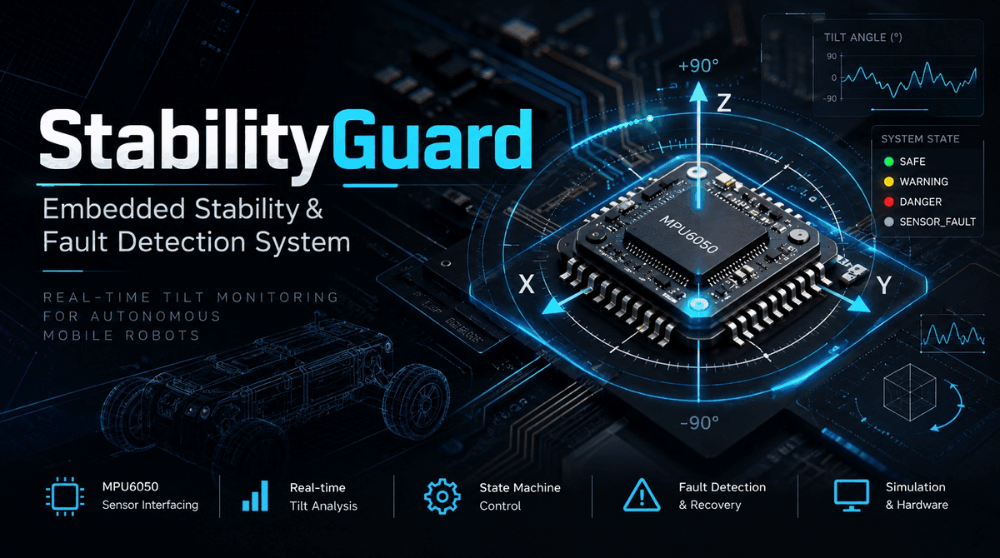

[](#10-automated-testing--verification-hierarchy)
[](#6-physical-hardware-implementation--pico-2-w)
[](#3-live-simulation--circuit-overview)
[](https://wokwi.com/projects/478987065565532161)
[](#2-system-architecture)
[](#6-physical-hardware-implementation--pico-2-w)

**An embedded stability-monitoring and fault-detection prototype for potential autonomous mobile robot (AMR) applications—verified in Wokwi on the Pico W and demonstrated on physical Pico 2 W hardware.**

[Explore Wokwi Simulation](#3-live-simulation--circuit-overview) • [Physical Hardware & Photos](#6-physical-hardware-implementation--pico-2-w) • [Watch Hardware Demo](media/hardware/StabilityGuard_Hardware_Demo.mp4) • [Pico 2 W Hardware Firmware](Hardware_Pico2w/) • [Live Wokwi Simulation](https://wokwi.com/projects/478987065565532161) • [Test Evidence](evidence/automated_test_log.txt) • [Architecture Guide](docs/architecture.md)

</div>

---

## 1. Project Overview & Engineering Motivation

Autonomous mobile robots (AMRs), automated guided vehicles (AGVs), and rough-terrain robotic platforms operate in dynamic industrial and agricultural environments where terrain gradient shifts, payload imbalances, and floor irregularities pose severe rollover hazards. 

In safety-critical embedded systems, relying on raw accelerometer measurements or naive threshold checks introduces three core failure modes:
1. **Mechanical Vibration & Transient Acceleration Spikes**: Wheel impacts and motor vibrations corrupt instantaneous gravity vector calculations, triggering nuisance alarms or emergency e-stops.
2. **Sensor Bus Interruptions & Fault Propagation**: Intermittent I²C bus stalls, clock-stretching lockups, or register corruption freeze control loops unless isolated by deterministic fault-recovery state machines.
3. **Rollover After Recovery**: Resetting from a sensor fault by blindly assuming a `SAFE` state can lead to catastrophic machinery failure if the vehicle is still resting at a critical angle.

**StabilityGuard** solves these challenges by combining integer-based acceleration vector validation, 64-bit integer square root math, tangent table interpolation, exponential moving average (EMA) jitter attenuation, asymmetric hysteresis state transitions, and real-time fault recovery.

---

## 2. System Architecture

StabilityGuard separates platform-independent core monitoring logic from hardware-dependent peripheral drivers. The following diagram describes the **Pico W simulation reference**; the physical Pico 2 W configuration is documented in [hardware validation](docs/hardware_validation.md):

```
+-----------------------------------------------------------------------------------+
|                         Raspberry Pi Pico W Firmware                              |
|                                 (sketch.ino)                                      |
|                                                                                   |
|  +--------------------+    +--------------------+    +-------------------------+  |
|  |  MPU6050 (0x68)    |    |  SSD1306 (0x3C)    |    | Actuation & Indicators  |  |
|  |  16,384 LSB/g      |    |  128x64 OLED       |    | LEDs: GP10, GP11, GP12  |  |
|  |  Shared I2C0 Bus   |    |  Shared I2C0 Bus   |    | Buzzer: GP13 PWM        |  |
|  |  10 Hz Sampling    |    |  4 Hz Telemetry    |    | Button: GP14 (Active-L) |  |
|  +---------+----------+    +---------^----------+    +------------^------------+  |
|            | Raw Counts (x, y, z)    | Display Telemetry          | Non-blocking  |
+------------|-------------------------|----------------------------|---------------+
             |                         |                            |
             v                         |                            |
+--------------------------------------+----------------------------|---------------+
|                             StabilityGuard.h                                      |
|                                                                                   |
|  1. Vector Sanity Check : 8192^2 <= (x^2 + y^2 + z^2) <= 24576^2 (0.5g to 1.5g)   |
|  2. Fixed-Point Math    : 64-bit isqrt64(x^2 + y^2) & 46-point tangent table      |
|  3. Dynamic Filtering   : Exponential Moving Average (alpha = 0.35)               |
|  4. Dual Hysteresis     : Warning (12°-15° deadband), Danger (26°-30° deadband)   |
|  5. Asymmetric Debounce : 3 consecutive samples escalate, 5 samples de-escalate   |
|  6. Direct Fault Return : 5-sample recovery with real-time state reclassification|
+-----------------------------------------------------------------------------------+
```

### State Machine Transition Topology
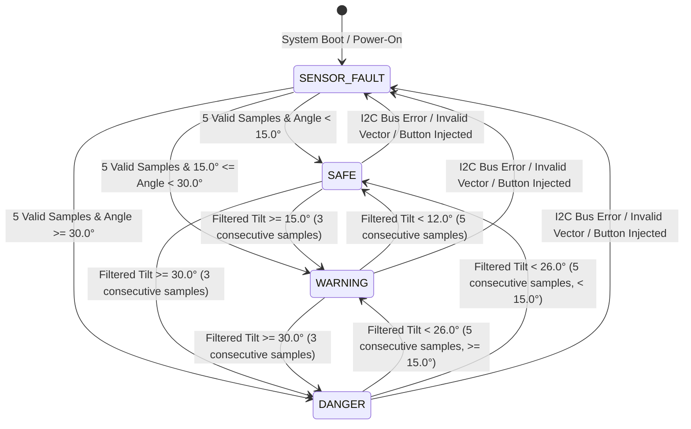

---

## 3. Live Simulation & Circuit Overview

The full interactive circuit simulation runs in the browser on the **Wokwi Embedded Simulator**:

🔗 **[Open Verified Wokwi Project 478987065565532161](https://wokwi.com/projects/478987065565532161)**

<div align="center">

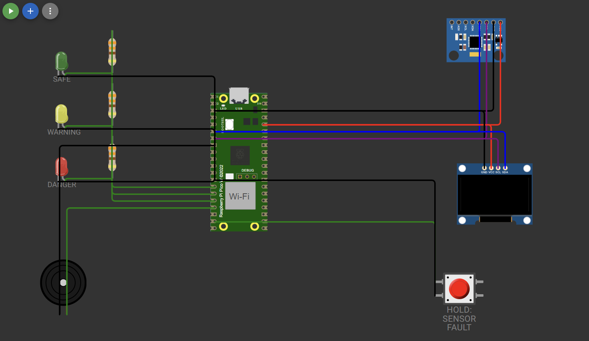
*Figure 1: Verified Wokwi simulation breadboard showing Raspberry Pi Pico W, GY-521 MPU6050, SSD1306 OLED, status LEDs, piezo buzzer, and fault-injection pushbutton.*

</div>

---

## 4. Hardware Peripherals & Pin Mapping

This table describes the original **Pico W simulation**. The physical Pico 2 W uses the same GPIO assignments, but its OLED is **128×32** rather than 128×64; see [the physical pinout and validation guide](docs/hardware_validation.md).

| Component | Pin / Interface | Pico GPIO | Function & Electrical Parameters |
|---|---|:---:|---|
| **Raspberry Pi Pico W** | Core MCU | - | RP2040 Dual-Core ARM Cortex-M0+ @ 133 MHz, 264 KB SRAM |
| **MPU6050 IMU** | `SDA` / `SCL` | `GP4` / `GP5` | 3-axis accelerometer configured for $\pm 2g$ full-scale ($16,384 \text{ LSB/g}$), I²C address `0x68` |
| **SSD1306 OLED (128x64)** | `SDA` / `SCL` | `GP4` / `GP5` | Live numerical tilt angle, operational state, graphical severity gauge, and fault diagnostics, I²C address `0x3C` |
| **Green Status LED** | Anode via $330\Omega$ | `GP12` | Indicates **SAFE** operational state (tilt $< 15.0^\circ$) |
| **Yellow Status LED** | Anode via $330\Omega$ | `GP11` | Indicates **WARNING** state (tilt $\ge 15.0^\circ$); flashes synchronously during fault |
| **Red Status LED** | Anode via $330\Omega$ | `GP10` | Indicates **DANGER** state (tilt $\ge 30.0^\circ$); flashes synchronously during fault |
| **Piezo Buzzer** | Positive terminal | `GP13` | Emits distinct non-blocking alarm cadences ($1000\text{ Hz}$ in DANGER, $420\text{ Hz}$ in FAULT) |
| **Fault Pushbutton** | Active LOW | `GP14` | Injects instantaneous hardware fault / sensor bus disconnect simulation |

---

## 5. Operational States & Visual Simulation Evidence

The detailed OLED descriptions below refer to the **128×64 Wokwi simulation**. The 128×32 physical screen uses a more compact layout.

StabilityGuard classifies operating conditions into four mutually exclusive states, visually rendered on the hardware indicators and SSD1306 OLED display:

| State | Tilt Angle Threshold | Actuators & Indicators | OLED Display Interface |
|:---:|:---:|---|---|
| **SAFE** | $\theta < 15.0^\circ$ | Green LED **ON**<br>Yellow/Red LEDs **OFF**<br>Buzzer silent | Displays filtered angle ($0.0^\circ$ nominal), `STATE: SAFE`, `[OK . . ]` gauge |
| **WARNING** | $15.0^\circ \le \theta < 30.0^\circ$ | Yellow LED **ON**<br>Green/Red LEDs **OFF**<br>Buzzer silent | Displays live angle, `STATE: WARNING`, `[######. . ]` gauge |
| **DANGER** | $\theta \ge 30.0^\circ$ | Red LED **ON**<br>Green/Yellow LEDs **OFF**<br>Buzzer $1000\text{ Hz}$ beep ($90\text{ ms}$ pulse every $600\text{ ms}$) | Displays live angle, `STATE: DANGER`, `[###########!CRIT]` gauge |
| **SENSOR_FAULT** | Invalid vector / Bus disconnect | Yellow + Red LEDs **flashing** ($350\text{ ms}$)<br>Buzzer $420\text{ Hz}$ chirp ($120\text{ ms}$ every $1000\text{ ms}$) | Angle masked (`--.- deg`), `STATE: SENSOR_FAULT`, `FAULT: <REASON>` |

### Observed Simulation Captures

| SAFE State Operation | WARNING State Operation |
|:---:|:---:|
| 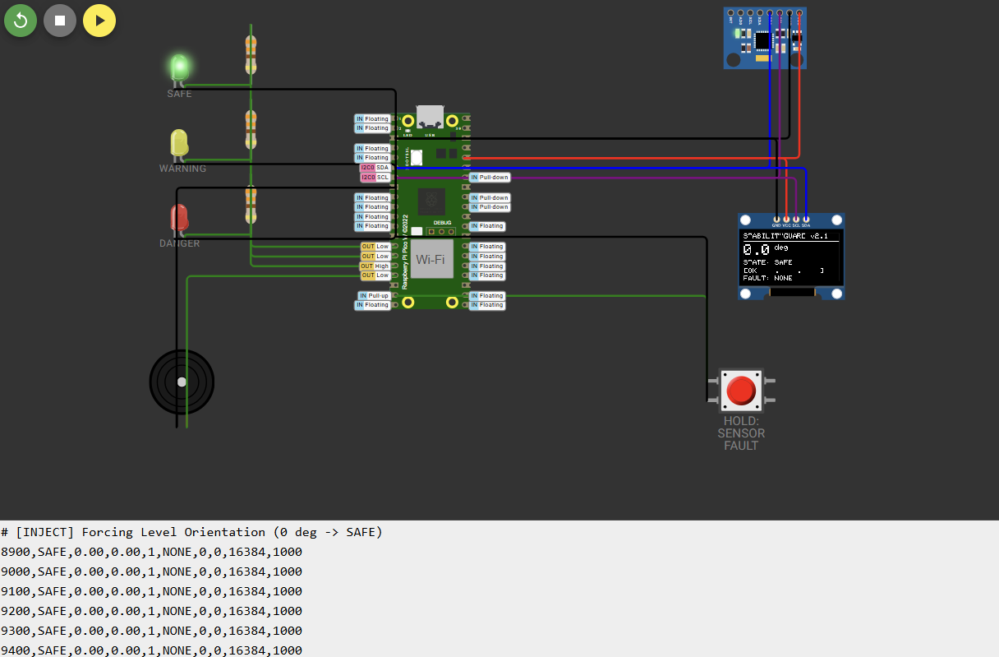<br><sub>**Figure 2:** Level platform ($0.0^\circ$): Green LED ON, OLED confirms SAFE, buzzer silent.</sub> | 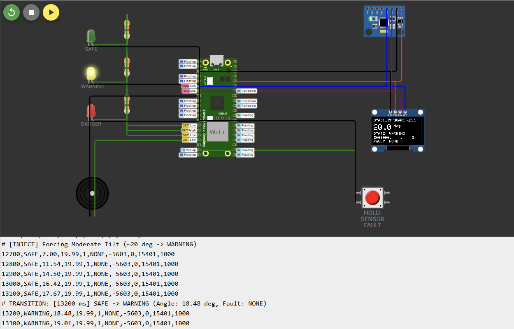<br><sub>**Figure 3:** Moderate tilt ($20.0^\circ$): Yellow LED ON, OLED confirms WARNING.</sub> |

| DANGER State Operation | SENSOR_FAULT State Operation |
|:---:|:---:|
| 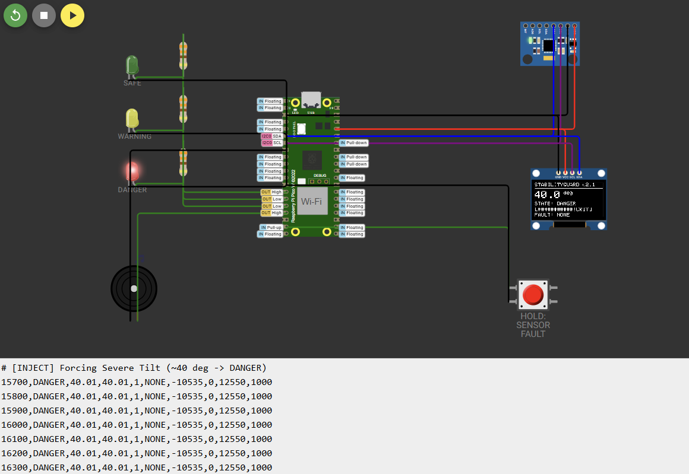<br><sub>**Figure 4:** Severe tilt ($40.0^\circ$): Red LED ON, OLED confirms DANGER, critical alarm sounding.</sub> | 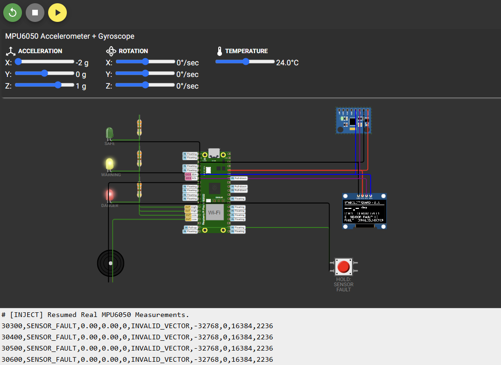<br><sub>**Figure 5:** Out-of-range simulated acceleration (approximately 2.236g) triggers `SENSOR_FAULT` / `INVALID_VECTOR`; warning indicators and OLED show the fault.</sub> |

---

## 6. Physical Hardware Implementation — Pico 2 W

StabilityGuard has been implemented and bench-tested on a **Raspberry Pi Pico 2 W**, building on the earlier Pico W simulation. The assembled prototype includes an MPU6050-labeled motion module, a **128×32 SSD1306 OLED**, three status LEDs, a piezo buzzer, and a fault-injection button.

**Physical tests demonstrated live tilt monitoring, SAFE / WARNING / DANGER indication, audible alarms, SENSOR_FAULT injection, and recovery.** The following photographs document the actual physical build and each operating state.

<div align="center">

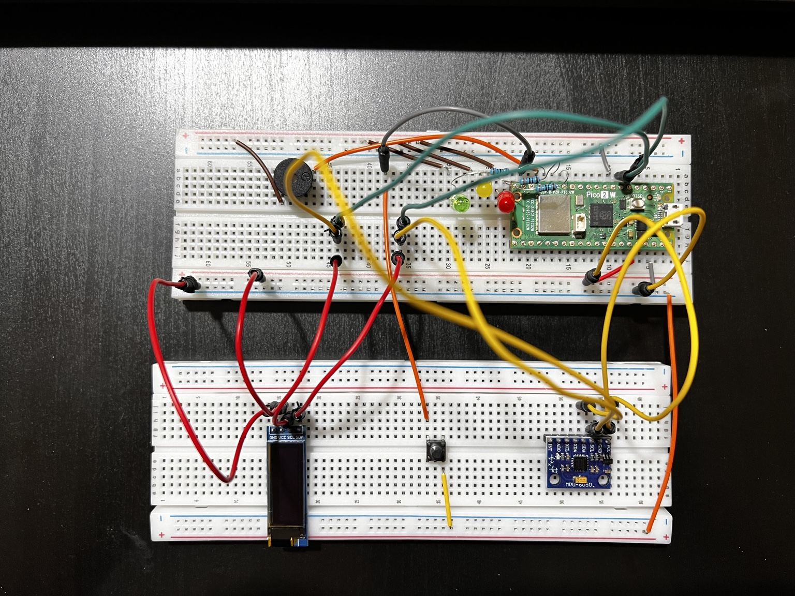

*Physical Pico 2 W prototype, with all modules and indicators connected.*

</div>

| SAFE | WARNING |
|:---:|:---:|
| 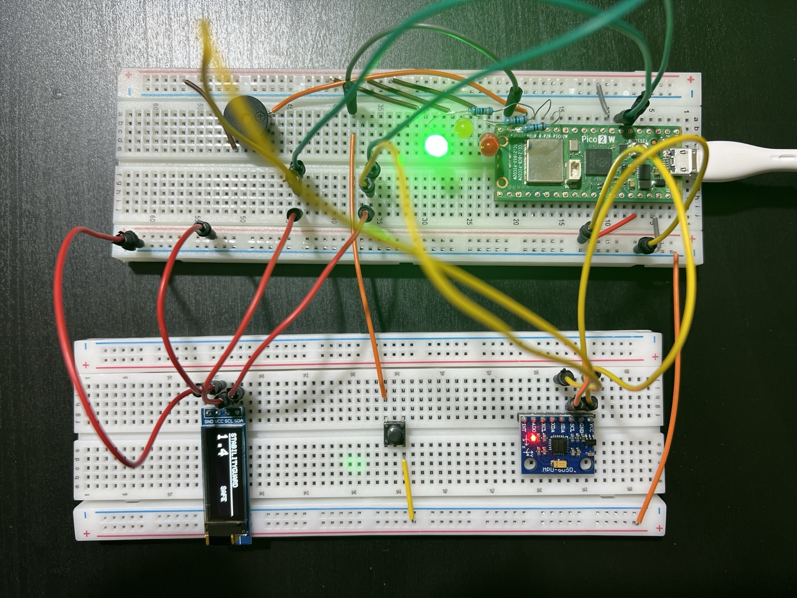 | 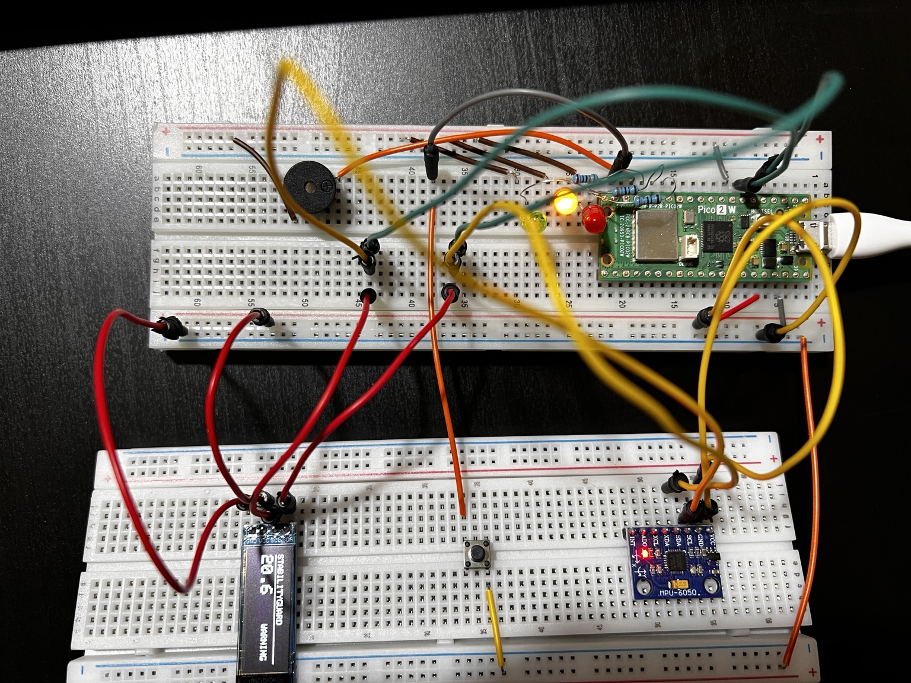 |

| DANGER | SENSOR_FAULT |
|:---:|:---:|
| 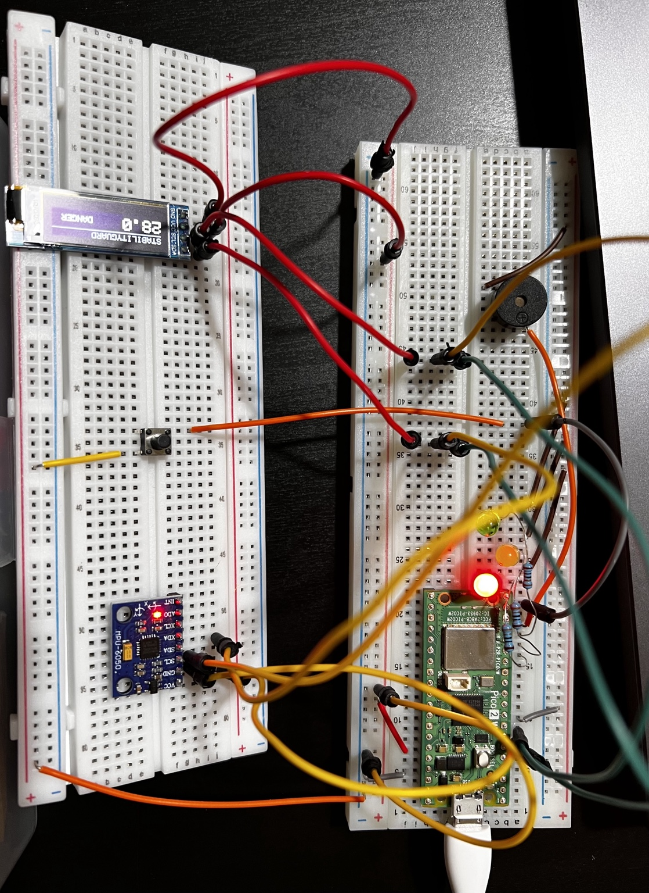 | 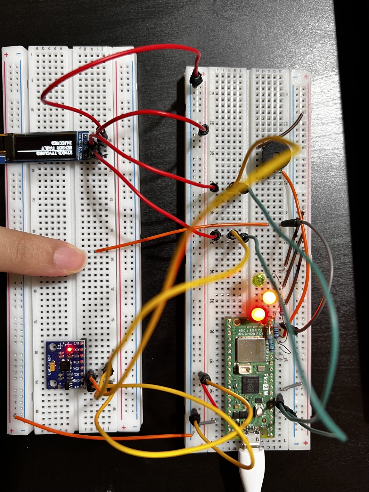 |

**[▶ Watch the real hardware demonstration (MP4)](media/hardware/StabilityGuard_Hardware_Demo.mp4)** · **[Physical firmware folder](Hardware_Pico2w/)** · **[Hardware validation and wiring](docs/hardware_validation.md)**

**Simulation vs. physical hardware:** The Wokwi reference runs on a **Pico W with a 128×64 OLED**. The physical prototype uses a **Pico 2 W with a 128×32 OLED** and a separate hardware startup routine. The two firmware versions are preserved independently, sharing the core state-machine implementation. The physical sketch is kept in [`Hardware_Pico2w/`](Hardware_Pico2w/); its `StabilityGuard.h` dependency must be in that folder alongside the `.ino` file for an Arduino IDE build.

---

---

## 7. Algorithmic Principles & Implementation Details

### 1. Raw-Integer Acceleration Magnitude Validation
Before computing angles, the engine validates that the measured static acceleration vector approximates the local gravitational field ($1.0g \pm 0.5g$):
$$\text{MIN\_MAG\_SQ} \le x^2 + y^2 + z^2 \le \text{MAX\_MAG\_SQ}$$
$$8192^2 \le x^2 + y^2 + z^2 \le 24576^2 \quad (\text{counts}^2)$$
Any reading outside this window ($|a| < 0.5g$ or $|a| > 1.5g$) is immediately classified as `INVALID_VECTOR`, protecting against free-fall drops, collision impacts, and disconnected sensor floating buses.

### 2. 64-bit Integer Square Root & Tangent Table Interpolation
To reduce reliance on floating-point math for the magnitude and angle-ratio calculations:
1. **Horizontal Magnitude**:
   $$h = \text{isqrt64}(x^2 + y^2)$$
   Calculated using a 64-bit integer Newton-Raphson approximation.
2. **Angle Calculation**:
   $$\theta = \arctan2(h, z)$$
   Evaluated using a 46-point precomputed lookup table ($\text{round}(16384 \cdot \tan\theta)$ for $\theta \in [0^\circ, 45^\circ]$) combined with linear interpolation and cotangent reflection for $[45^\circ, 90^\circ]$ and $[90^\circ, 180^\circ]$. Angle interpolation uses a bounded lookup table; floating-point arithmetic is still used for interpolation and EMA filtering.

### 3. Exponential Moving Average (EMA) Jitter Attenuation
Raw angular measurements are smoothed using a first-order recursive filter at $10\text{ Hz}$ ($\Delta t = 100\text{ ms}$):
$$f_N = \alpha \cdot \theta_N + (1 - \alpha) \cdot f_{N-1}, \quad \text{where } \alpha = 0.35$$
This provides a cutoff frequency that attenuates high-frequency chassis vibrations while preserving an agile rise time ($90\%$ step response achieved within 6 samples / $600\text{ ms}$).

### 4. Asymmetric Debouncing & Hysteresis Deadbands
To prevent oscillation and relay chattering near classification boundaries:
* **Hysteresis Deadbands**:
  * Warning Entry: $15.0^\circ$ | Warning Exit: $12.0^\circ$ ($3.0^\circ$ deadband)
  * Danger Entry: $30.0^\circ$ | Danger Exit: $26.0^\circ$ ($4.0^\circ$ deadband)
* **Asymmetric Debounce Timing**:
  * **Escalation** (SAFE $\to$ WARNING, WARNING $\to$ DANGER): Requires **3 consecutive samples** ($300\text{ ms}$) meeting or exceeding the entry threshold.
  * **De-escalation** (DANGER $\to$ WARNING, WARNING $\to$ SAFE): Requires **5 consecutive samples** ($500\text{ ms}$) strictly below the exit threshold.

### 5. Deterministic Fault Recovery
When recovering from `SENSOR_FAULT`:
* The system mandates **5 consecutive valid sensor samples** before clearing the fault condition.
* The recovered state is evaluated directly by reclassifying the filtered angle (`classify(filtered_tilt_deg)`). If the platform is still tilted at $40^\circ$ when the sensor reconnects, it transitions directly to `DANGER`, preventing hazardous actuation.

### 6. Idempotent Zero-Reference Resting Calibration
The `'c'` serial command computes resting bias offsets:
* Queries raw sensor counts directly via `readRawHardwareAccel()` rather than already-offset values, ensuring repeated calibrations are idempotent and do not cause offset drift.
* Incorporates an $8.7^\circ$ ($2500$ counts) tilt guard: if an operator attempts calibration on an incline, the routine rejects the operation to prevent masking an active rollover hazard.

---

## 8. Interactive Serial Test Harness

The firmware includes an interactive serial command interpreter operating at 115,200 baud:

<div align="center">

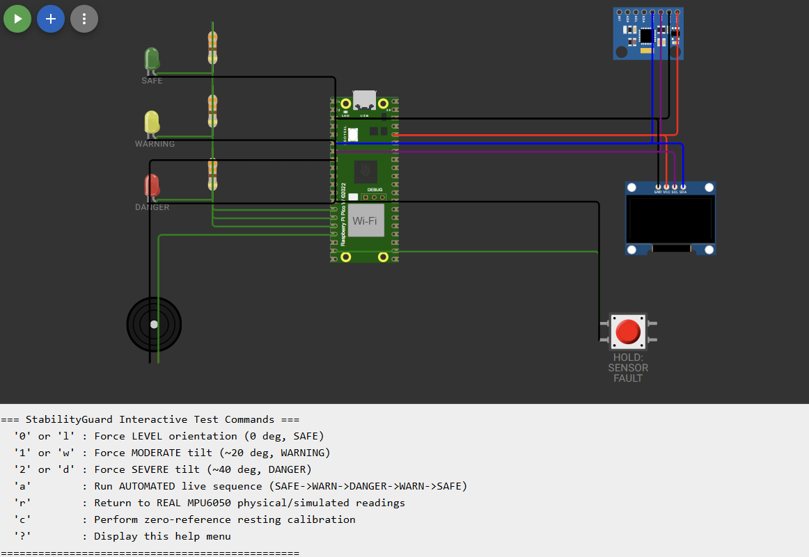
*Figure 6: Live Wokwi Serial Monitor showing the interactive test harness command menu and real-time execution feedback.*

</div>

| Command Key | Action | Observed System Response |
|:---:|---|---|
| `'0'` or `'l'` | Force **Level** Orientation ($0.0^\circ$) | Transitions to **SAFE**; Green LED ON; Buzzer silent |
| `'1'` or `'w'` | Force **Moderate Tilt** ($19.99^\circ$) | Transitions to **WARNING** after 3 samples; Yellow LED ON |
| `'2'` or `'d'` | Force **Severe Tilt** ($40.01^\circ$) | Transitions to **DANGER** after 3 samples; Red LED ON; 1000 Hz alarm beeps |
| `'a'` | Run **Automated Demonstration Cycle** | Automatically cycles: SAFE $\to$ WARNING $\to$ DANGER $\to$ WARNING $\to$ SAFE (20s run) |
| `'r'` | Return to **Real MPU6050 Readings** | Resumes reading raw simulated physics values from Wokwi canvas |
| `'c'` | **Zero-Reference Calibration** | Averages 20 resting samples; stores hardware bias offsets (guarded to $\le 8.7^\circ$) |
| `'?'` or `'h'` | Display Command Menu | Prints interactive menu and status |

---

## 9. Actual Automated Test Results & Telemetry Analysis

During the final verification run in Wokwi, the automated demonstration sequence (`'a'`) was executed. The complete raw serial stream was captured and preserved in [`evidence/automated_test_log.txt`](evidence/automated_test_log.txt).

### Observed Transition Chronology (from `evidence/automated_test_log.txt`)

| Timestamp | Pre-Transition State | New Transition State | Filtered Angle | Target Angle | Debounce Criteria Satisfied |
|:---:|:---:|:---:|:---:|:---:|---|
| **32,800 ms** | `SENSOR_FAULT` | **`SAFE`** | $0.00^\circ$ | $0.00^\circ$ | 5th consecutive valid sample on level boot |
| **36,900 ms** | `SAFE` | **`WARNING`** | $18.48^\circ$ | $19.99^\circ$ | 3 consecutive samples $\ge 15.0^\circ$ (samples: 16.42°, 17.67°, 18.48°) |
| **40,700 ms** | `WARNING` | **`DANGER`** | $36.44^\circ$ | $40.01^\circ$ | 3 consecutive samples $\ge 30.0^\circ$ (samples: 31.55°, 34.51°, 36.44°) |
| **45,000 ms** | `DANGER` | **`WARNING`** | $20.97^\circ$ | $19.99^\circ$ | 5 consecutive samples $< 26.0^\circ$ (de-escalation damping) |
| **48,900 ms** | `WARNING` | **`SAFE`** | $1.51^\circ$ | $0.00^\circ$ | 5 consecutive samples $< 12.0^\circ$ (de-escalation damping) |

### Telemetry Vector Visualization

The actual recorded dataset was processed through [`analysis/telemetry_analysis.py`](analysis/telemetry_analysis.py) to generate this vector plot:

<div align="center">

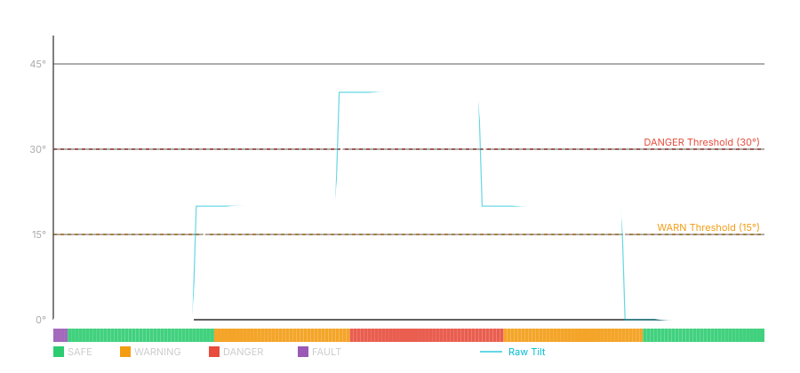
*Figure 7: Vector plot of actual Wokwi simulation telemetry showing raw tilt (cyan), filtered tilt (white), and colored background operational state regions.*

</div>

* **Total Samples Logged**: 200 samples @ 10.1 Hz (~19.90 seconds)
* **State Occupancy**: SAFE: 38.0% | WARNING: 38.5% | DANGER: 21.5% | SENSOR_FAULT: 2.0%
* **Filter Convergence**: Step to $40.01^\circ$ reached $39.47^\circ$ by sample 10, exactly matching the theoretical EMA convergence:
  $$f_{10} = 40.01 \cdot \left(1 - 0.65^{10}\right) = 39.47^\circ$$

---

## 10. Automated Testing & Verification Hierarchy

StabilityGuard uses a three-tiered testing hierarchy to validate the firmware:

```
+-------------------------------------------------------------------------------+
|                       Three-Tiered Verification Hierarchy                     |
+-------------------------------------------------------------------------------+
|  Tier 1: Standalone Native C++ Suite (tests/test_stability_guard.cpp)         |
|          Validates core safety logic, fixed-point math, and hysteresis dead-   |
|          bands with zero hardware or Arduino dependencies.                    |
|                                                                               |
|  Tier 2: Automated Python Regression Suite (tests/test_runner.py)             |
|          Independent cross-platform test model verifying 20/20 scenarios with |
|          closed-form mathematical expectations.                               |
|                                                                               |
|  Tier 3: Wokwi Interactive End-to-End Simulation (Pico W Target)               |
|          Full peripheral integration: shared I²C bus arbitration, non-blocking|
|          PWM buzzer, discrete LEDs, SSD1306 OLED, and physical fault button.  |
+-------------------------------------------------------------------------------+
```

**Additional physical verification:** The Pico 2 W assembly was separately bench-tested with live MPU readings, OLED updates, all three LED states, buzzer behavior, and fault-button recovery. Details and photographs: [Physical Hardware Verification](docs/hardware_validation.md). This hands-on check is separate from the Python and native C++ tests listed below.

### Running the Test Suite
```bash
# Run the 20-scenario Python regression test suite:
python tests/test_runner.py

# Or compile and execute the standalone native C++ suite:
g++ -std=c++11 -Wall -Wextra -O2 tests/test_stability_guard.cpp -o test_stability_guard
./test_stability_guard
```

### Test Results Matrix (20/20 Scenarios Passing)

| ID | Test Scenario | Verified Condition | Status |
|:---:|---|---|:---:|
| **01** | Startup State | Boots into `SENSOR_FAULT`, `valid=false`, stage=`STARTUP` | **PASS** |
| **02** | 5-Sample Recovery | Requires exactly 5 consecutive valid readings before entering SAFE | **PASS** |
| **03** | Stable SAFE Operation | Level reading ($0.0^\circ$) stable with $< 0.05^\circ$ error; $1000\text{ mg}$ magnitude | **PASS** |
| **04** | WARNING Entry & Convergence | Enters `WARNING` after 3 qualifying samples; converges within $0.6^\circ$ of $20^\circ$ | **PASS** |
| **05** | DANGER Entry & Convergence | Enters `DANGER` after 3 qualifying samples; converges within $1.0^\circ$ of $40^\circ$ | **PASS** |
| **06** | Direct SAFE $\to$ DANGER | Direct step to $45^\circ$ reaches `DANGER` without entering `WARNING` | **PASS** |
| **07** | DANGER $\to$ WARNING | De-escalates cleanly after 5 qualifying samples below $26.0^\circ$ | **PASS** |
| **08** | WARNING $\to$ SAFE | Returns to `SAFE` after 5 qualifying samples below $12.0^\circ$ | **PASS** |
| **09** | Hysteresis Boundary Immunity | Holds `WARNING` state at $13^\circ$ (between $12^\circ$ exit and $15^\circ$ entry) | **PASS** |
| **10** | Timing Asymmetry | Confirms 3 samples to escalate vs. 5 samples to de-escalate | **PASS** |
| **11** | Transient Spike Rejection | Single-sample $45^\circ$ tilt spike in SAFE is filtered without tripping alarm | **PASS** |
| **12** | Zero Vector Rejection | Acceleration vector $(0, 0, 0)$ trips `INVALID_VECTOR` fault | **PASS** |
| **13** | Excessive Acceleration Rejection | $> 1.5g$ ($32,767$ counts) trips `INVALID_VECTOR` fault | **PASS** |
| **14** | Sensor Read Failure Handling | I²C communication transaction failure trips `READ_FAILURE` fault | **PASS** |
| **15** | Injected Fault Button Detection | Hardware pushbutton press immediately trips `INJECTED` fault | **PASS** |
| **16** | 5-Sample Fault Recovery to SAFE | Releasing fault button recovers cleanly to `SAFE` after 5 valid samples | **PASS** |
| **17** | Tilted Fault Recovery to DANGER | Sensor recovering while severely tilted ($40^\circ$) transitions directly to `DANGER` | **PASS** |
| **18** | Filter State Reset After Fault | Fault clears old tilt history; no ghost bias carries over | **PASS** |
| **19** | Extreme Angle Precision | Validated numerical precision at $0^\circ$, $90^\circ$, and $180^\circ$ | **PASS** |
| **20** | Full Cyclic Transition Sequence | SAFE $\to$ WARNING $\to$ DANGER $\to$ WARNING $\to$ SAFE full loop | **PASS** |

*Structured machine-readable test results are preserved in [`tests/test_report.json`](tests/test_report.json).*

---

## 11. Engineering Design Decisions & Trade-Offs

| Engineering Challenge | Selected Solution | Evaluated Trade-Off / Rationale |
|---|---|---|
| **Shared I²C Bus Stalls** | Explicit STOP frames (`Wire.endTransmission(true)`) | Using STOP transactions was stable in the verified Pico W simulation; the precise cause of earlier bus errors was not conclusively isolated. |
| **Timer Interrupt Corruption** | Asynchronous polling (`tone(pin, freq)` + manual `noTone()`) | Timestamp-based buzzer stopping avoided the duration-based alarm path and coincided with stable simulator behavior; an interrupt collision was not independently proven. |
| **Rollover After Sensor Loss** | Dynamic classification upon recovery | Blindly assuming a vehicle is `SAFE` upon sensor reconnection is hazardous. Evaluating the real-time tilt angle on the 5th recovery sample ensures direct transition to `DANGER` if tilted. |
| **Repeated Calibration** | Query raw registers via `readRawHardwareAccel()` | Reading uncorrected counts prevents previously stored offsets from being subtracted a second time during calibration; accuracy remains subject to sensor and measurement conditions. |

---

## 12. Verified Scope & Known Limitations

1. **Simulation reference**: The Wokwi logs and screenshots verify the **Pico W (`board-pi-pico-w`)** simulation, including automated state transitions.
2. **Physical integration**: A separate **Pico 2 W** build was bench-tested with actual tilt sensing, OLED states, LEDs, buzzer, and button-triggered fault/recovery behavior. See [physical validation](docs/hardware_validation.md). Those are functional prototype tests, not formal certification or calibrated accuracy measurements.
3. **Simulator compatibility**: Earlier Wokwi trials using `board-pi-pico-2w` produced `ANGLE_MATH_INVALID`; the simulator-specific cause was not isolated. Successful **physical Pico 2 W** testing does not establish that Wokwi's Pico 2 W simulator behaves identically.
4. **Sensor identity**: The sensor module returned nonstandard `WHO_AM_I = 0x72` at I²C address `0x68`. Hardware-specific initialization handles the observed response.
5. **Tilt estimation**: Accelerometer-only gravity estimation can be distorted by dynamic acceleration.
---

## 13. How to Reproduce in Wokwi

1. Open the verified project in your browser:  
   👉 **[https://wokwi.com/projects/478987065565532161](https://wokwi.com/projects/478987065565532161)**
2. Click **Start Simulation**.
3. Open the **Serial Monitor** tab in Wokwi (115,200 baud).
4. Verify initial self-test output:
   ```text
   === StabilityGuard v2.1.1 Production Simulation ===
   # [SELFTEST] Level (0,0,16384): PASS stage=OK magSq=268435456
   # [MPU] WHO_AM_I verified: 0x68
   # [MPU] Initialization OK, sensor ready.
   ```
5. Type `'a'` and press Enter to trigger the automated 20-second demonstration cycle.
6. Click and hold the red **HOLD: SENSOR FAULT** button on the canvas to observe real-time fault injection and recovery.

---
